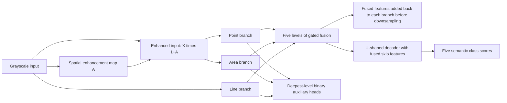

# Method and implementation contract

## Network

MGS-Net is a five-level, three-branch encoder with a U-shaped decoder. Base width
is 32 in the full configuration, and successive encoder widths are 32, 64, 128,
256 and 512. The model uses group normalization and ReLU activations.



The point branch uses two 3×3 convolutions. The area branch concatenates a 5×5
path with a dilation-2 3×3 path and projects with 1×1 convolution. The line branch
concatenates horizontal (1×9 then dilation-2 1×5) and vertical (9×1 then dilation-2
5×1) paths. Branch names describe their supervision, not a hard restriction on
what features they may respond to.

At each level, a 1×1 convolution on concatenated branch features produces three
spatial scores. Softmax turns them into weights summing to one. Their weighted
sum is refined by convolution and used as a decoder skip feature. At levels before
the bottleneck, the fused result is also added to each branch before downsampling.
PixelUnshuffle moves 2×2 spatial neighborhoods into channels, followed by a learned
1×1 projection. The rearrangement retains pixels; the subsequent projection is a
compression, so the whole downsampling block is not claimed to be lossless.

Only point and area inputs receive `X * (1 + A)`. The line input is `X`. Each binary
auxiliary head reads its branch's deepest feature. Its two-channel scores are
bilinearly upsampled to the input size, with `align_corners=False`. For a 128×256
input, the native auxiliary map is 8×16. The three heads are independently trained;
their foreground outputs can overlap.

## Annotation-derived shape targets

Semantic IDs are background=0, incomplete penetration=1, lack of fusion=2,
porosity=3 and slag inclusion=4. Shape IDs are background=0, point=1, area=2 and
line=3. There is no extra manually annotated shape dataset.

- Incomplete penetration and lack of fusion map to line.
- Slag inclusion maps to line when its bounding-box aspect ratio is at least 3.
- Remaining porosity and slag inclusion map to point if geometric area is below
  128 pixels, otherwise area. Circle area is πr²; polygon area uses the shoelace formula.
- For aspect ratio, divide the longer bounding-box side by `max(shorter side, 1)`.
  A circle has aspect ratio one. Shapes are drawn in annotation order; later shapes
  overwrite earlier ones at overlaps, for both semantic and shape targets.

Pillow draws circles and polygons into the original pixel grid. Rasterized pixel
counts are not substituted for the geometric area used in shape assignment.

## Training objective

The full recipe is:

```text
L = 0.5 L_focal + 0.3 L_dice + 0.2 L_boundary
  + 0.2 L_aux + 0.03 L_direction + 0.03 L_horizontal
```

Focal loss emphasizes difficult semantic pixels (gamma=2; class weights
`[0.2, 1, 1, 1, 1]`). Dice loss measures overlap, averaging foreground classes over
the batch and image axes. The boundary term uses differentiable max-pooling-based
morphological boundaries and bands of radius two. It averages only classes with a
nonempty target boundary. It is a training objective, not an evaluation boundary metric.

The auxiliary loss is the mean of the three branches' cross-entropy plus binary
foreground Dice losses, calculated after score upsampling. Each branch receives
its own foreground/background target derived from shape IDs.

For the direction term, average-pool semantic probabilities by four and nearest-neighbor
downsample the labels. Within each eligible class, sample at most 16 foreground
coordinates at evenly spaced indices in row-major order. They are **reference pixels,
not object centers**. Soft distance weighting (temperature 0.08) defines a direction
field toward a smooth combination of these references. The loss penalizes probability
gradients opposing that field inside the target class. It is a soft penalty and does
not guarantee star convexity. Class weights are `[0, 0, 0, 1, 0.8]`. Eligible class/sample
terms are averaged including zero-weight terms, preserving the implemented reduction.

The horizontal term also downsamples by four. For incomplete penetration and lack
of fusion, it penalizes horizontal probability changes within target regions plus
half the positive part of vertical changes exceeding 0.05. Only adjacent pairs
inside the same class are used. Class weights are `[0, 1, 1, 0, 0]`. Both morphology
priors skip class/sample regions with fewer than eight downsampled pixels.

The priors and auxiliary supervision apply during training. Label-free prediction
uses the decoder's main semantic scores.

## Optimization and evaluation

The full YAML supplies Adam, learning rate 0.0008, weight decay zero, cosine scheduling
over at most 200 epochs to 0.000001, seed 42 and batch size 64. The best checkpoint is
selected by validation mean Dice; patience is 40 epochs without improvement. Hardware
and batching choices should be adapted to the user's machine. A fixed seed helps
repeat runs but does not promise identical training across platforms or devices.

Evaluation first accumulates a confusion matrix across the whole selected split.
For each class, `IoU = TP/(TP+FP+FN)` and `Dice = 2TP/(2TP+FP+FN)`, with numerical
epsilon `1e-7`. TP denotes correctly assigned pixels, FP incorrectly predicted
class pixels and FN missed class pixels. Means exclude background and classes
without target pixels; if there are no eligible classes, both means are zero.
Background pixels are retained when counting foreground false positives.

